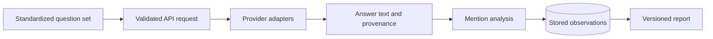
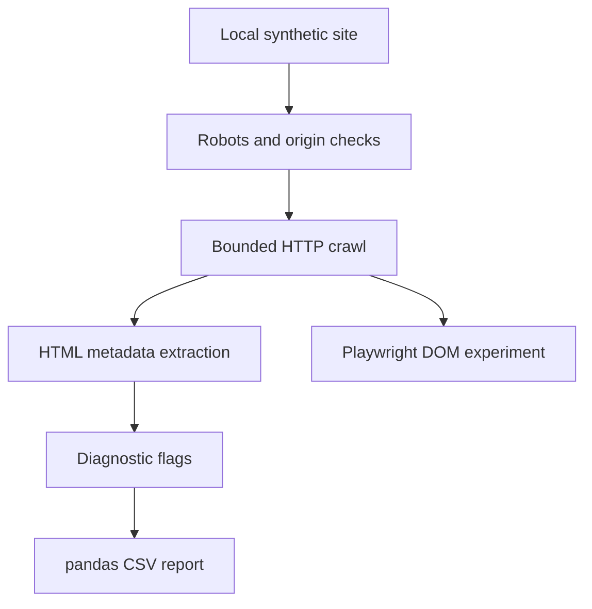

# GEO Research Portfolio

**Haoxiang Liu | Generative Engine Optimization, information retrieval, and reproducible AI evaluation**

This portfolio presents selected implementation evidence from a personal GEO Analysis Assistant and a separate website-audit experiment. The complete V1 application remains in a private development repository; this public-sharing edition contains selected source samples rather than a deployable copy of that application. The website-audit module is independently runnable.

## 1. GEO Analysis Assistant (V1)

The project investigates how organizations can compare brand mentions in language-model answers across standardized questions and model configurations, while retaining the evidence behind each measurement.

### Implemented capabilities in the original V1 application

| Component | Implementation |
| --- | --- |
| Application | Next.js, React, TypeScript and Zod-validated API route handlers |
| Model adapters | OpenAI, Doubao, DeepSeek, Kimi and Mock through a shared interface |
| Evaluation | Up to 10 questions per batch; up to 5 brands or model configurations per comparison |
| Measurement | Case-insensitive substring matching, occurrence count and mention rate |
| Persistence | Prisma / SQLite; project, analysis run, detection and report version records |
| Reporting | Raw answer text, historical runs, report versions and rule-based suggestions |
| Delivery | Local Docker Compose configuration, database health endpoint and smoke-check script |

### Selected source evidence

- [Mention detection](geo-v1-code-samples/brand-mention.ts): original TypeScript function for case-insensitive substring counts and first position.
- [Provider interface](geo-v1-code-samples/provider-types.ts): original shared interface and provider/model attribution fields.
- [Data model](geo-v1-code-samples/schema.prisma): schema snapshot showing the four core entities and relationships; contains no actual database records.

The mention rate is the proportion of successful detection records containing the target string. Failed requests are recorded separately. The method is a baseline, not a measure of recommendations, ranking, market share, or causal GEO impact. The model adapters use chat completions rather than verified consumer search results. Mock responses are workflow fixtures, not empirical measurements. The full V1 application was inspected at source level for this portfolio, not redeployed or re-tested during this preparation.

## 2. Website Audit — independent proof of concept

A small AI-assisted Python experiment demonstrates bounded crawling, HTML extraction, metadata diagnostics, browser-based rendering and structured CSV reporting. The experiment is separate from the V1 application and uses a synthetic loopback HTTP fixture, not a live university website.

**Start here:** [Implementation and reproduction instructions](website-audit/README.md)

| Evidence | Result |
| --- | --- |
| [Crawler and diagnostic implementation](website-audit/audit.py) | Requests, BeautifulSoup, robots.txt, bounded traversal, HTTP status and redirect detection |
| [Structured report](website-audit/sample_outputs/audit.csv) | 6 URL records; 5 records with diagnostic flags |
| [Browser run log](website-audit/sample_outputs/run.txt) | Chromium extracted JavaScript-generated H1 text |
| [Regression tests](website-audit/test_audit.py) | 8 test cases, including scope and page-limit checks |
| [Test log](website-audit/sample_outputs/test-results.txt) | 8 passed on the assistant's local Linux environment |

### Scope and research limitations

The crawler deliberately does not accept arbitrary public URLs. Browser verification renders retrieved fixture HTML in Chromium with network requests blocked; it does not navigate a live website. The accessibility checks only flag missing image-alt attributes, not WCAG compliance. Canonical tags are extracted, not validated. Search relevance, PDF accessibility, semantic clustering and full V2 agent orchestration remain future work.

The website-audit code was developed with AI assistance and tested in the assistant's execution environment. Independent reproduction and understanding by the portfolio owner are still required before representing this experiment as personal proficiency.

## 3. Research interests

My interests include traceable AI evaluation, search relevance, content discoverability, entity alias matching, and translating diagnostic evidence into actionable recommendations. Future extensions would investigate stronger entity matching, repeated sampling, accurate model attribution, and evidence-linked diagnostic agents.

## Sharing scope

Only selected source samples and synthetic test artifacts are provided. No API keys, customer records, private databases, private development history, or employer-owned materials are intentionally included. No production-service readiness or commercial performance is claimed.
